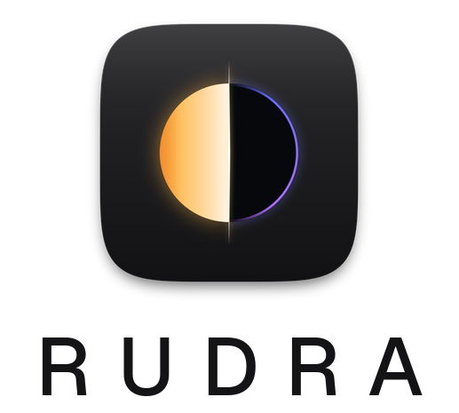
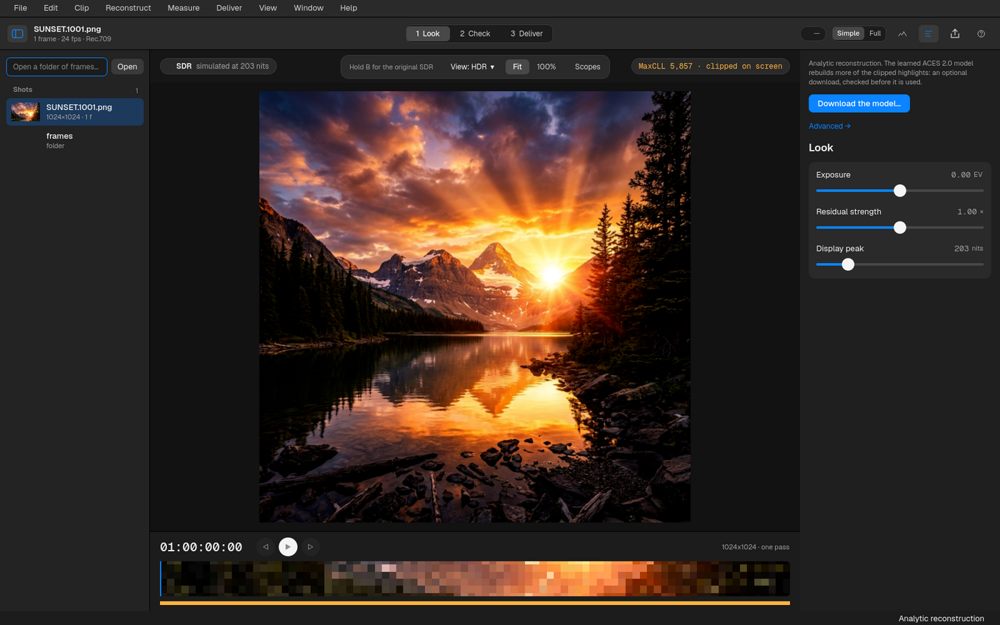
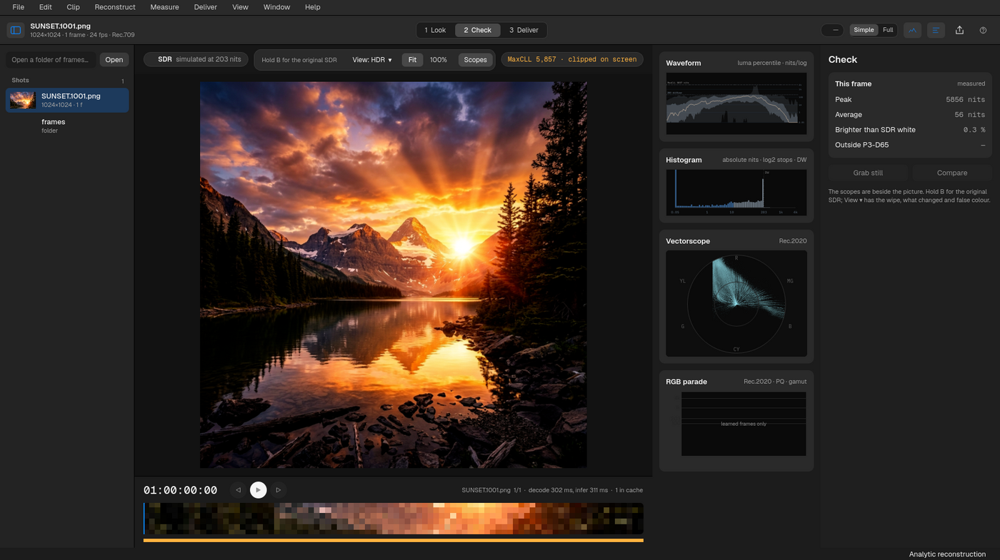

<p align="center">
  <picture>
    <source media="(prefers-color-scheme: dark)" srcset="ui/assets/brand/rudra_logo_dark.png">
    
  </picture>
</p>

<p align="center">
  <b>SDR in, HDR out.</b><br>
  RUDRA turns SDR stills and footage into scene-referred HDR masters,<br>
  and shows you exactly what it added.
</p>

<p align="center">
  <a href="https://www.fxtdstudios.com/rudra"></a>
</p>

<p align="center">
  <a href="https://github.com/FXTD-Studios/RUDRA/releases/latest"></a>
  <a href="https://github.com/FXTD-Studios/RUDRA/releases/latest"></a>
  <a href="LICENSE"></a>
  <a href="https://huggingface.co/fxtdstudios/rudra-models"></a>
  <a href="https://www.fxtdstudios.com/rudra-docs/"></a>
  <br>
  <a href="https://github.com/FXTD-Studios/RUDRA/actions/workflows/tests.yml"></a>
  <a href="https://github.com/FXTD-Studios/RUDRA/actions/workflows/native.yml"></a>
  <a href="https://github.com/FXTD-Studios/RUDRA/actions/workflows/shipped_model.yml"></a>
</p>

---

## What it does

An 8-bit SDR frame throws away everything brighter than its white. RUDRA puts it
back. It reads the SDR through the curve that made it, rebuilds the highlights the
SDR clipped, and writes a master you can grade, deliver or hand to a colourist:
ACES EXR, HDR10, HLG, ProRes or DPX.

You stay in control. Every step is live on screen, the viewer opens as a wipe with
the original SDR beside RUDRA's result, and RUDRA marks every pixel it had to
invent.

<p align="center">
  
  <br><sub><b>1 Look</b>: open a shot and shape its HDR. Hold B for the original SDR, W for a wipe.</sub>
</p>

<p align="center">
  
  <br><sub><b>2 Check</b>: peak, average and light above SDR white, with the scopes beside the picture.</sub>
</p>

## Download

**[Download the latest release](https://github.com/FXTD-Studios/RUDRA/releases/latest)**:
Windows 10 / 11 (x64, installer or portable ZIP) and macOS (Apple silicon, DMG),
with their checksums and the release notes.

The builds are not code-signed yet. On Windows, choose **More info › Run anyway**
in the SmartScreen prompt. On macOS, open it once from **System Settings › Privacy
& Security › Open Anyway**.

On the first start, **Welcome to RUDRA** checks your display (HDR or SDR, and its
real peak), names your GPU, and finds any model you have installed. No licence
to accept, no account.

## Three steps

1. **Look.** Open a still, a folder of frames or a movie (MOV, MP4, MXF, MKV and
   more). The viewer opens as a wipe, the original SDR on the left and RUDRA on
   the right, at a 1,000-nit display peak. Set the exposure, the strength and the
   peak; press **W** to turn the wipe off, or hold **B** to see the original SDR.
2. **Check.** Read the peak, the average light, how much is above SDR white and
   how much is outside P3, with the scopes beside the picture. **Invented pixels**
   shows what RUDRA made up.
3. **Deliver.** Pick a preset: **Grading master** (ACES EXR), **HDR10 movie**,
   **Broadcast HDR** (HLG), or **Custom…** for everything else. Files are written
   whole or not at all, and nothing is ever overwritten.

New users start in the **Simple** workspace. **Full** has every control: masks,
per-region exposure, batch queues, EDL conform and more.

## The learned model (optional)

RUDRA works out of the box with its analytic reconstruction. For more of the
clipped light, download the learned model, **RUDRA ACES 2**, from inside the app:
**Look › Download the model…** or **File › Model packages…**. It is free and
checked file by file before use, and needs RUDRA 1.2.0 or later.

It is the exact inverse of the ACES 2.0 SDR output, held to your delivered SDR by
the lock: its master renders back to the SDR within one 8-bit code. On held-out
production footage it passed every registered gate, rebuilding clipped highlights
and shadows better than the plain inverse at −3 and +3 EV (the numbers are in
[docs/MODELS.md](docs/MODELS.md)). Use it on SDR that was made through ACES 2.0;
for any other grade the analytic route is the better tool, and the app says so
when the Source curve is not ACES. The models are also on
[Hugging Face](https://huggingface.co/fxtdstudios/rudra-models).

**AI fill** (experimental, off by default) can draw detail inside large blown
areas. It needs the Wan2.1-VACE-1.3B base model and a 16 GB GPU (on a Mac, 16 GB
of memory or more); set it up with `scripts\GENFILL.ps1 -Setup` on Windows or
`scripts/genfill_setup.sh` on a Mac. What it draws is
a plausible guess, not recovered detail, so check every frame.

## System requirements

- **Windows** 10 or 11, x64. The learned model runs on any DirectX 12 GPU
  (DirectML); without one, on the CPU.
- **macOS** on Apple silicon. The learned model runs on the CPU, or on the GPU /
  Neural Engine through Core ML; AI fill runs on the GPU through Metal.
- An HDR display is recommended for judging the result. RUDRA also simulates HDR
  on an SDR screen.

## Help

- [User guide](https://www.fxtdstudios.com/rudra-docs/): every control, step by step
- [Release notes](https://github.com/FXTD-Studios/RUDRA/releases/latest)
- [Report a problem](https://github.com/FXTD-Studios/RUDRA/issues)
- [Report a security problem privately](SECURITY.md)
- Developers and researchers: [project overview](docs/PROJECT_OVERVIEW.md),
  [building from source](native/README.md), [training](docs/TRAINING.md)

## For developers

The Python package (reference pipeline, training, the browser Studio) and its tests:

```bash
pip install torch --index-url https://download.pytorch.org/whl/cpu   # or your CUDA build
pip install -e ".[test]"
pytest tests/ -q
```

The native app (C++20, Qt 6) builds with CMake; see [native/README.md](native/README.md).

Continuous integration (`native` and `shipped model` run when their files change):

| Workflow | What it checks |
|---|---|
| [`tests`](.github/workflows/tests.yml) | pytest on Python 3.10 and 3.13; the WebGL viewer against the EXR it writes |
| [`native`](.github/workflows/native.yml) | the layer rule; the C++ core against Python goldens on Windows, macOS and Linux; Gate A (LibTorch vs ONNX Runtime); the Qt shell; the Gate B HDR probe |
| [`shipped model`](.github/workflows/shipped_model.yml) | RUDRA ACES 2, as users download it, through the native engine (weekly too) |
| [`release`](.github/workflows/release.yml) | on a `v*` tag: the Windows installer and ZIP and the macOS DMG, checked for model weights, published as a release |

## Licence

Copyright 2026 FXTD Studios. The code and the current models (RUDRA ACES 2,
AI fill v3) are licensed under the [Apache License 2.0](LICENSE): free for
commercial use. Keep the [`LICENSE`](LICENSE) and [`NOTICE`](NOTICE) files when
you redistribute.

The packages carry no model weights; each model is a download that shows its
licence first. The older Beta 2 weights (`sdr2hdr_image_v8`, `sdr2hdr_shadow_v1`)
are non-commercial ([`checkpoints/LICENSE`](checkpoints/LICENSE)). Packages up to
1.0.1 bundled `sdr2hdr_image_v8` by mistake: update to the latest release, or delete
`models/sdr2hdr_image_v8` from an older install, before commercial work. Every
model, its licence and its status: [docs/MODELS.md](docs/MODELS.md).

---

<p align="center"><a href="https://www.fxtdstudios.com">www.fxtdstudios.com</a> · FXTD Studios</p>
