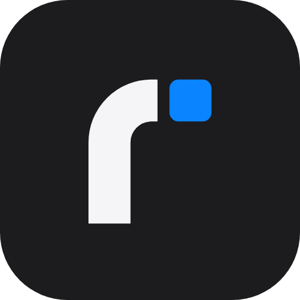
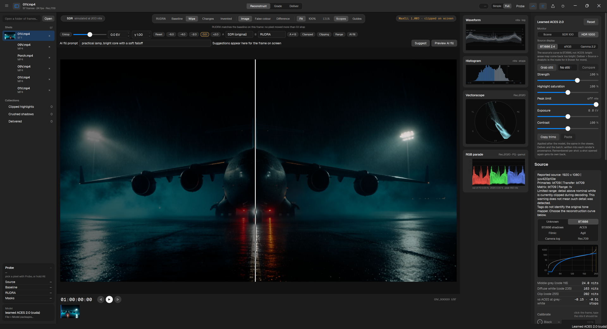

<p align="center">
  
</p>

<h1 align="center">RUDRA</h1>

<p align="center">
  <b>SDR in, HDR out.</b><br>
  RUDRA turns SDR stills and footage into scene-referred HDR masters,<br>
  and shows you exactly what it added.
</p>

<p align="center">
  <a href="https://www.fxtdstudios.com/rudra"></a>
</p>

<p align="center">
  <a href="https://github.com/FXTD-Studios/RUDRA/releases/latest"></a>
  <a href="https://github.com/FXTD-Studios/RUDRA/releases/latest"></a>
  <a href="LICENSE"></a>
  <a href="https://huggingface.co/fxtdstudios/rudra-models"></a>
  <a href="https://www.fxtdstudios.com/rudra-docs/"></a>
  <br>
  <a href="https://github.com/FXTD-Studios/RUDRA/actions/workflows/tests.yml"></a>
  <a href="https://github.com/FXTD-Studios/RUDRA/actions/workflows/native.yml"></a>
  <a href="https://github.com/FXTD-Studios/RUDRA/actions/workflows/shipped_model.yml"></a>
</p>

---

## What it does

An 8-bit SDR frame throws away everything brighter than its white. RUDRA puts it
back. It reads the SDR through the curve that made it, rebuilds the highlights the
SDR clipped, and writes a master you can grade, deliver or hand to a colourist:
ACES EXR, HDR10, HLG, ProRes or DPX.

You stay in control. Every step is live on screen, the viewer opens as a wipe with
the original SDR beside RUDRA's result, and RUDRA marks every pixel it had to
invent.

<p align="center">
  
  <br><sub>Open a shot, compare the SDR original with RUDRA as a wipe, and check it on the scopes.</sub>
</p>

## Download

**[Download the latest release](https://github.com/FXTD-Studios/RUDRA/releases/latest)**:
Windows 10 / 11 (x64, installer or portable ZIP), macOS (Apple silicon, DMG) and Linux
(x86-64, tar.gz), each with its SHA-256 checksum and the release notes.

**The builds are not code-signed yet** ([why, and how to check a download](#code-signing-policy)):

- **Windows:** SmartScreen may say "Windows protected your PC" once: choose
  **More info › Run anyway**.
- **macOS:** right-click RUDRA.app › **Open** › **Open**, or **System Settings › Privacy &
  Security › Open Anyway**.

Download RUDRA only from this repository's
[Releases page](https://github.com/FXTD-Studios/RUDRA/releases).

On the first start, **Welcome to RUDRA** checks your display (HDR or SDR, and its
real peak), names your GPU, and finds any model you have installed. No licence
to accept, no account, no telemetry: the only automatic connection is a daily
update check, which the installer and **Help** let you turn off
([privacy policy](docs/PRIVACY.md)).

## Three steps

1. **Look.** Open a still, a folder of frames or a movie (MOV, MP4, MXF, MKV and
   more), or drop it on the window. The viewer opens as a wipe, the original SDR on the left and RUDRA on
   the right, at a 1,000-nit display peak. Set the exposure, the strength and the
   peak; press **W** to turn the wipe off, or hold **B** to see the original SDR.
2. **Check.** Read the peak, the average light, how much is above SDR white and
   how much is outside P3, with the scopes beside the picture. **Invented pixels**
   shows what RUDRA made up.
3. **Deliver.** Pick a preset: **Grading master** (ACES EXR), **HDR10 movie**,
   **Broadcast HDR** (HLG), or **Custom…** for everything else. Files are written
   whole or not at all, and nothing is ever overwritten.

New users start in the **Simple** workspace. **Full** has every control: masks,
per-region exposure, batch queues, EDL conform and more.

## The learned model (optional)

RUDRA works out of the box with its analytic reconstruction. For more of the
clipped light, download the learned model, **RUDRA ACES 2**, from inside the app:
**Look › Download the model…** or **File › Model packages…**. It is free and
checked file by file before use, and needs RUDRA 1.2.0 or later.

It is the exact inverse of the ACES 2.0 SDR output, held to your delivered SDR by
the lock: its master renders back to the SDR within one 8-bit code. On held-out
production footage it passed every registered gate, rebuilding clipped highlights
and shadows better than the plain inverse at −3 and +3 EV (the numbers are in
[docs/MODELS.md](docs/MODELS.md)). Use it on SDR that was made through ACES 2.0;
for any other grade the analytic route is the better tool, and the app says so
when the Source curve is not ACES. The models are also on
[Hugging Face](https://huggingface.co/fxtdstudios/rudra-models).

**AI fill** (experimental, off by default) draws what the SDR never held. It has
two modes, each its own model download:

- **AI fill v3** fills only fully clipped pixels: a lamp's core, a sun, glints.
- **Region re-render (v4)**, new in 1.2.4, draws a whole bright region again: a
  window, an open door, a sky parked just under white. Name what is there in a
  short prompt. It is tested on the analytic route; on fast-moving water it can
  flicker slightly.

Both need the Wan2.1-VACE-1.3B base model and a 16 GB GPU (on a Mac, 16 GB of
memory or more); set it up with `scripts\GENFILL.ps1 -Setup` on Windows or
`scripts/genfill_setup.sh` on a Mac. What it draws is a plausible guess, not
recovered detail, so check every frame.

## System requirements

- **Windows** 10 or 11, x64. The learned model runs on any DirectX 12 GPU
  (DirectML); without one, on the CPU.
- **macOS** on Apple silicon. The learned model runs on the CPU, or on the GPU /
  Neural Engine through Core ML; AI fill runs on the GPU through Metal.
- An HDR display is recommended for judging the result. RUDRA also simulates HDR
  on an SDR screen.

## Help

- [User guide](https://www.fxtdstudios.com/rudra-docs/): every control, step by step
  (the same guide as text: [docs/USER_GUIDE.md](docs/USER_GUIDE.md))
- [Release notes](https://github.com/FXTD-Studios/RUDRA/releases/latest)
  ([1.2.5 in this repository](docs/RELEASE_NOTES_1.2.5.md))
- [Report a problem](https://github.com/FXTD-Studios/RUDRA/issues)
- [Report a security problem privately](SECURITY.md)
- Developers and researchers: [project overview](docs/PROJECT_OVERVIEW.md),
  [building from source](native/README.md), [training](docs/TRAINING.md)

## For developers

The Python package (reference pipeline, training, the browser Studio) and its tests:

```bash
pip install torch --index-url https://download.pytorch.org/whl/cpu   # or your CUDA build
pip install -e ".[test]"
pytest tests/ -q
```

The native app (C++20, Qt 6) builds with CMake; see [native/README.md](native/README.md).

Continuous integration (`native` and `shipped model` run when their files change):

| Workflow | What it checks |
|---|---|
| [`tests`](.github/workflows/tests.yml) | pytest on Python 3.10 and 3.13; the WebGL viewer against the EXR it writes |
| [`native`](.github/workflows/native.yml) | the layer rule; the C++ core against Python goldens on Windows, macOS and Linux; Gate A (LibTorch vs ONNX Runtime); the Qt shell; the Gate B HDR probe |
| [`shipped model`](.github/workflows/shipped_model.yml) | RUDRA ACES 2, as users download it, through the native engine (weekly too) |
| [`release`](.github/workflows/release.yml) | on a `v*` tag: the Windows installer and ZIP and the macOS DMG, checked for model weights, published as a release |

## Code signing policy

**Status: unsigned.** Every release so far, up to and including the latest, is published
without a code-signing certificate. RUDRA has applied to [SignPath Foundation](https://signpath.org/)
for free code signing for open-source projects; the application has **not been approved yet**.
The release workflow is ready for it: once it is approved, the Windows programs and installer of
each new release are signed, and this section and the release notes will say from which version.
Releases published before that stay unsigned.

**Until then, check what you download.** Each file on the
[Releases page](https://github.com/FXTD-Studios/RUDRA/releases) has a `.sha256` file beside it.
Compare the two:

```powershell
# Windows (PowerShell)
(Get-FileHash .\RUDRA-<version>-windows-x64-setup.exe -Algorithm SHA256).Hash
```

```sh
# macOS / Linux
shasum -a 256 RUDRA-<version>-macos-arm64.dmg
sha256sum RUDRA-<version>-linux-x86_64.tar.gz
```

The value must match the first word of the `.sha256` file. Every release is built from its
tagged commit on GitHub-hosted runners by
[`.github/workflows/release.yml`](.github/workflows/release.yml), never on a team member's
computer, and each package is checked to carry no model weights.

**When signing starts:** free code signing provided by [SignPath.io](https://about.signpath.io/),
certificate by SignPath Foundation. What will be signed, who approves each release, and what RUDRA
sends over the network: [docs/CODE_SIGNING_POLICY.md](docs/CODE_SIGNING_POLICY.md) and
[docs/PRIVACY.md](docs/PRIVACY.md). The macOS app is signed separately
([docs/MACOS_SIGNING.md](docs/MACOS_SIGNING.md)); until a Developer ID certificate is set up it is
signed ad hoc only.

## Licence

Copyright 2026 FXTD Studios. The code and the current models (RUDRA ACES 2,
AI fill v3 and v4) are licensed under the [Apache License 2.0](LICENSE): free for
commercial use. Keep the [`LICENSE`](LICENSE) and [`NOTICE`](NOTICE) files when
you redistribute.

The packages carry no model weights; each model is a download that shows its
licence first. The older Beta 2 weights (`sdr2hdr_image_v8`, `sdr2hdr_shadow_v1`)
are non-commercial ([`checkpoints/LICENSE`](checkpoints/LICENSE)). Packages up to
1.0.1 bundled `sdr2hdr_image_v8` by mistake: update to the latest release, or delete
`models/sdr2hdr_image_v8` from an older install, before commercial work. Every
model, its licence and its status: [docs/MODELS.md](docs/MODELS.md).

---

<p align="center"><a href="https://www.fxtdstudios.com">www.fxtdstudios.com</a> · FXTD Studios</p>
