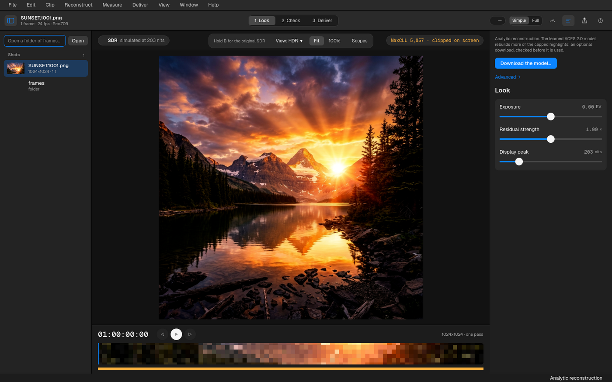
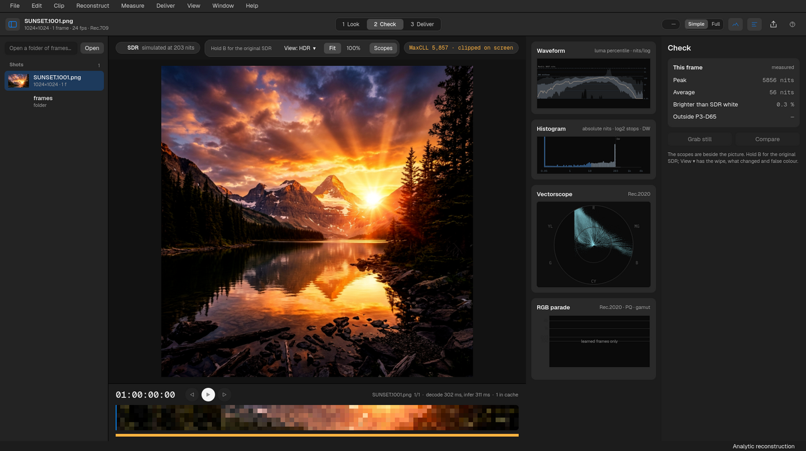

  <picture>
    <source media="(prefers-color-scheme: dark)" srcset="ui/assets/brand/rudra_logo_dark.png">
    
  </picture>

  <b>SDR in, HDR out.</b> 
  RUDRA turns SDR stills and footage into scene-referred HDR masters, 
  and shows you exactly what it added.

  
  

  
  
  
  
  

---

## What it does

An 8-bit SDR frame throws away everything brighter than its white. RUDRA puts it
back. It reads the SDR through the curve that made it, rebuilds the highlights the
SDR clipped, and writes a master you can grade, deliver or hand to a colourist:
ACES EXR, HDR10, HLG, ProRes or DPX.

You stay in control. Every step is live on screen, the original SDR is one key
away, and RUDRA marks every pixel it had to invent.

  
   <b>1 Look</b>: open a shot and shape its HDR. Hold B for the original SDR, W for a wipe.

  
   <b>2 Check</b>: peak, average and light above SDR white, with the scopes beside the picture.

## Download

| | |
|---|---|
| **Windows 10 / 11** (x64) | [Installer](https://github.com/FXTD-Studios/RUDRA/releases/download/v1.0.1/RUDRA-1.0.1-windows-x64-setup.exe) · [Portable ZIP](https://github.com/FXTD-Studios/RUDRA/releases/download/v1.0.1/RUDRA-1.0.1-windows-x64.zip) |
| **macOS** (Apple silicon) | [DMG](https://github.com/FXTD-Studios/RUDRA/releases/download/v1.0.1/RUDRA-1.0.1-macos-arm64.dmg) |

All files, checksums and release notes are on the
[releases page](https://github.com/FXTD-Studios/RUDRA/releases/latest).

The builds are not code-signed yet. On Windows, choose **More info › Run anyway**
in the SmartScreen prompt. On macOS, open it once from **System Settings › Privacy
& Security › Open Anyway**.

## Three steps

1. **Look.** Open a still, a folder of frames or a movie (MOV, MP4, MXF, MKV and
   more). Set the exposure, the strength and your display's peak. Hold **B** to
   see the original SDR, or press **W** for a wipe: SDR on the left, RUDRA on the
   right.
2. **Check.** Read the peak, the average light, how much is above SDR white and
   how much is outside P3, with the scopes beside the picture. **Invented pixels**
   shows what RUDRA made up.
3. **Deliver.** Pick a preset: **Grading master** (ACES EXR), **HDR10 movie**,
   **Broadcast HDR** (HLG), or **Custom…** for everything else. Files are written
   whole or not at all, and nothing is ever overwritten.

New users start in the **Simple** workspace. **Full** has every control: masks,
per-region exposure, batch queues, EDL conform and more.

## The learned model (optional)

RUDRA works out of the box. For more of the clipped light, download the learned
**ACES 2.0** model from inside the app: **Look › Download the model…** or
**File › Model packages…**. It is free and checked file by file before use. The
models are also on [Hugging Face](https://huggingface.co/fxtdstudios/rudra-models).

**AI fill** (experimental, off by default) can draw detail inside large blown
areas. It needs a 16 GB GPU and the Wan2.1-VACE-1.3B base model. What it draws is
a plausible guess, not recovered detail, so check every frame.

## System requirements

- **Windows** 10 or 11, x64. The learned model runs on NVIDIA (CUDA) or any
  DirectX 12 GPU (DirectML); without one, on the CPU.
- **macOS** on Apple silicon. In 1.0 the learned model and AI fill are Windows
  features.
- An HDR display is recommended for judging the result. RUDRA also simulates HDR
  on an SDR screen.

## Help

- [User guide](https://www.fxtdstudios.com/rudra-docs/): every control, step by step
- [Release notes](https://github.com/FXTD-Studios/RUDRA/releases/latest)
- [Report a problem](https://github.com/FXTD-Studios/RUDRA/issues)
- Developers and researchers: [project overview](docs/PROJECT_OVERVIEW.md),
  [building from source](native/README.md), [training](docs/TRAINING.md)

## Licence

The code and the 1.0 models (learned ACES 2.0, AI fill v3) are licensed under the
[Apache License 2.0](LICENSE): free for commercial use. Keep the
[`LICENSE`](LICENSE) and [`NOTICE`](NOTICE) files when you redistribute.

The older Beta 2 weights (`sdr2hdr_image_v8`, `sdr2hdr_shadow_v1`) are
non-commercial; see [`checkpoints/LICENSE`](checkpoints/LICENSE). Each model shows
its licence in the app before you download it.

---

<a href="https://www.fxtdstudios.com">www.fxtdstudios.com</a> · FXTD Studios

