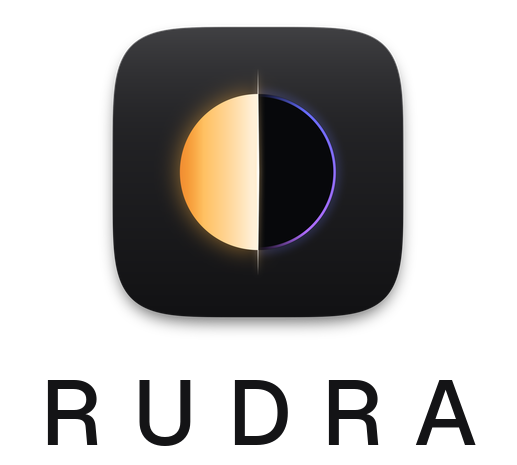

<p align="center">
  <picture>
    <source media="(prefers-color-scheme: dark)" srcset="../ui/assets/brand/rudra_logo_dark.png">
    
  </picture>
</p>

<p align="center">
  <b>R</b>adiance <b>U</b>niversal <b>D</b>ynamic <b>R</b>ange <b>A</b>dapter<br>
  Turns 8-bit SDR footage into scene-linear HDR, and tells you where it did it.<br>
  <sub>Light meets shadow: the 8-bit ceiling, split open.</sub>
</p>

<p align="center">
  
  
  <a href="../LICENSE"></a>
  <a href="https://www.fxtdstudios.com"></a>
  
  <a href="https://github.com/FXTD-Studios/RUDRA/releases/latest"></a>
  <a href="https://huggingface.co/fxtdstudios/rudra-models"></a>
  <a href="https://github.com/FXTD-Studios/RUDRA/actions/workflows/native.yml?query=branch%3Anative"></a>
  <a href="https://github.com/FXTD-Studios/RUDRA/actions/workflows/native.yml?query=branch%3Anative"></a>
  <a href="https://github.com/FXTD-Studios/RUDRA/actions/workflows/native.yml?query=branch%3Anative"></a>
</p>

> The project overview for developers and researchers: how RUDRA works, its results,
> the command lines and the research behind it. For the app itself, see the
> [README](../README.md).

---

**Contents:**
[What it does](#what-it-does) ·
[What's new](#whats-new) ·
[AI fill](#ai-fill-experimental) ·
[See it](#see-it) ·
[Results](#results) ·
[Install](#install) ·
[Quick start](#quick-start) ·
[Desktop app](#desktop-app) ·
[The browser Studio](#the-browser-studio) ·
[Command line](#command-line) ·
[Validation diagnostics](#validation-diagnostics) ·
[Known limitations](#known-limitations) ·
[Documentation](#documentation) ·
[Licence](#licence)

---

## What it does

An 8-bit frame throws away everything above the clip. RUDRA puts it back:
it reads the SDR through the inverse of the curve that made it, fills the
highlights the SDR clipped, and leaves the artist in control of every step,
live on an HDR display.

**RUDRA 1.0 ships on the analytic inverse with the artist in the loop**
(re-scoped 7 Oct 2026). No learned model has beaten the inverse on real SDR,
so the model is optional and off by default. What the artist gets:

- **Source**: a picker for the curve that made the SDR (BT.1886, the default
  for new sessions, ACES, filmic/Hable, AgX, camera log, Rec.709 clip),
  three-click calibration, and a match to a graded HDR reference.
- **Grade**: exposure in stops, peak, knee, Region EV bands with painted
  masks, anchor to the SDR's mid-tones, every control under one frame at 4K.
- **Clipped highlights** filled from the SDR alone, with a peak per region
  the artist can set, and an **Invented** layer that marks every pixel RUDRA
  made up.
- **Delivery**: ACES EXR masters, HDR10, HLG, ProRes 422 HQ / 4444 (PQ,
  ACEScct or LogC4) from a movie or a folder of frames, with audio, QC before
  publishing, HDR10+ and Dolby Vision L1/L6 metadata per shot, and holds that
  keep a shot steady over time.
- **Provenance**: every master records the app version, build commit, the
  source file's SHA-256 and, with the model on, the checkpoint's.

It ships as a native desktop app (Windows, macOS, Linux; no Python), the
browser Studio and two command lines (`rudra`, `rudra-native`).

**Since late October 2026** the app also has a **learned ACES 2.0 route**: a
small model (2 MB, in the C++ engine) that renders the master through the
exact inverse of the ACES 2.0 SDR view and rebuilds only what the 8-bit codes
cannot hold, and an optional, experimental **AI fill** for regions that are
fully clipped or crushed ([below](#ai-fill-experimental)). Three layers, each
honest about what it knows: the exact inverse, a constrained learned layer,
and a generative fill that is marked pixel by pixel.

**Scope.** RUDRA is one thing: SDR to HDR for any image or video, whatever made
it, whether a camera, a phone, an archive or any generative model. It works on
pixels, not on a model's latent space. The per-backbone VAE decoders (Flux,
Wan, LTX, SDXL, Qwen, Klein) and the latent-conditioning research pipeline are
**paused** as of 23 Sep 2026. Their code stays in `rudra/` and `training/` and
their results in [`STATUS.md`](STATUS.md), but they are not part of the product
and are not maintained.

---

## What's new

### In `v1.0.0` (27 to 31 Oct 2026)

- **The models on Hugging Face.** The learned ACES 2.0 model and the AI fill
  (LoRA + brightness estimator) are published at
  [huggingface.co/fxtdstudios/rudra-models](https://huggingface.co/fxtdstudios/rudra-models)
  under Apache 2.0, and download inside the app: File > Model packages, or
  Look > Download the model. Every file is checked against its SHA-256.
- **Apache 2.0.** The code is now licensed under the [Apache License 2.0](../LICENSE):
  commercial use is allowed. Each model keeps its own licence (see [Licence](#licence)).
- **Simple workspace.** New users start in *Simple*: three numbered tabs, **1 Look**
  (monitor and four trims), **2 Check** (peak, average, light above SDR white,
  out-of-P3 share, scopes beside the picture) and **3 Deliver** (Grading master,
  HDR10 movie, Broadcast HDR or Custom…). Hold **B** for the original SDR; one
  **View** menu for wipe, what changed, invented pixels and false colour. *Full*
  keeps every control.
- **First-run tips.** A welcome card, then four coach marks the first time a shot
  is open; Help > Show tips brings them back.
- **Model downloads and a new About** (in progress): models listed, downloaded,
  SHA-256-checked and installed from inside the app; About with the version, the
  model, the GPU and a link to [www.fxtdstudios.com](https://www.fxtdstudios.com).
- **User guide** updated for 1.0.0 RC 2:
  [www.fxtdstudios.com/rudra-docs](https://www.fxtdstudios.com/rudra-docs/).

- **New look.** A new app icon (one circle split by a line of light: gold
  highlights, deep shadows with a blue rim, on a graphite tile) and a start
  screen in the FXTD family layout, painted in code. Brand kit in
  [`ui/assets/brand/`](../ui/assets/brand).
- **AI fill (experimental, off by default).** Wan2.1-VACE-1.3B with a LoRA
  trained by FXTD on commercial-clean data fills only the fully clipped
  regions; no 8-bit code of the master's SDR view changes. The model draws the
  shape, a separately tested estimator sets the brightness, and
  **Highlight brightness** (±3 stops) lets you move it. It passed every
  registered gate on new scenes (30 Oct 2026). See [AI fill](#ai-fill-experimental).
- **The Deliver tab, rebuilt.** Learned ACES 2.0 or analytic; a still, a
  sequence or one MOV; EXR 32-bit float or 16-bit half in ACES 2065-1 or
  ACEScg, DPX 10-bit, ProRes 422 HQ / 4444 or uncompressed 16-bit RGB MOV;
  LogC4, ACEScct or the ACES 2.0 HDR 1000-nit PQ output. A Nuke-style file path
  (`SH010_hdr_v001.####.exr`); nothing is ever overwritten.
- **Batch queue** (Deliver > Batch queue…, Ctrl+Shift+B): shots, sequences and
  movies rendered one after another through the loaded model, each with its own
  settings, range and optional AI fill; it survives a restart.
- **Conform.** CMX 3600 EDL import into the batch, matched to the movies by clip
  name or reel, only the frames each edit uses plus handles; per-shot in/out
  ranges; MaxCLL / MaxFALL per shot.
- **For the colourist.** Source timecode and reel carried into the EXR header
  and the MOV; scopes and readouts on the learned route; trims (strength,
  highlight saturation, peak limit); monitoring through the ACES 2.0 SDR 100-nit
  or HDR 1000-nit output; the Invented layer, reference stills with wipe, and a
  playback proxy.

### On `native` since `v1.0.0-rc.2`

For the next release candidate. Per-beta detail: [`archive/docs/BETA.md`](../archive/docs/BETA.md).

- **Shot keyframes (roadmap 4.3).** A programme's grade can be kept per shot
  in a `<name>.shots.json`: keys inside a shot blend the continuous settings
  (strength, exposure, knees, Region EV bands, calibration nits) and step the
  rest; nothing reaches across a cut, and the holds reset at every shot.
  `rudra-native video ... --shots FILE` (or a queue's `shots`) exports a whole
  programme in one pass; the report lists each shot with its own flicker.
- **Conform by shot (5.4).** `rudra-native conform <movie>` makes the shots
  file from a CMX3600 EDL (drop frame, dissolves, clip names), an FCPXML's
  primary storyline, or the movie's own cuts (`--detect`).
- **Opt-in correction logging (5.2).** `rudra-native correction-log open | add |
  withdraw | export`: nothing is kept without a recorded consent (who, when,
  terms, rights holder); an accepted grade is kept as a 16-bit SDR / PQ HDR
  pair with its source hash, and `export` writes a training manifest the
  commercial preflight reads. A withdrawal stops logging and every export.
- **Dolby Vision from RUDRA itself (5.5).** `rudra-native dolby-vision` writes
  the per-shot metadata as a profile 8.1, CM v4.0 RPU (byte for byte what
  dovi_tool 2.3.1 generates, on 165 configs; injects into the HDR10 master) and
  as a Dolby Vision metadata XML (CM v4.0) that dovi_tool reads back.
- **OFX plug-in (5.1).** "RUDRA SDR to HDR" (`-DRUDRA_BUILD_OFX=ON`,
  `RUDRA.ofx.bundle`): the analytic reconstruction and the master chain on the
  CPU, Source, exposure, strength, recovery, clip fill and anchor as
  parameters, scene-linear Rec.2020 / ACEScg or PQ out. Loaded and rendered in
  a test host on the OpenFX SDK; not yet run in a commercial host.

- **A folder of frames exports to a movie.** HDR10, HLG, ProRes 422 HQ and
  4444 are offered for frame folders too: the frames are mastered as a linear
  Rec.2020 EXR sequence beside the movie, then encoded and checked as
  `rudra-native deliver` encodes them (measured MaxCLL/MaxFALL, tags verified,
  a frame rate picked on the export sheet). Master EXR stops it.
- **Stills keep their colour and orientation.** ICC profiles (PNG, JPEG, TIFF,
  WebP) and PNG cICP / sRGB / cHRM set the master's source primaries: sRGB /
  Rec.709, Display P3, Rec.2020 and Adobe RGB (1998) are recognised, an
  unknown profile is reported and read as Rec.709, untagged files are
  unchanged. EXIF orientation is applied. A tagged 16-bit PQ reference image
  converts from its own primaries.
- **Master provenance.** App version, build commit, source SHA-256, the
  checkpoint SHA-256 when the model ran, and whether the network really tiled
  (`rudra:tiled` was hard-coded).
- **Source: BT.1886 shadows (opt-in).** BT.1886 from SDR code 40 up and, below
  it, black levels measured on real graded HDR. BT.1886 stays the default.
- **Getting started.** A five-step guide on the first start, any time from
  Help > Getting started.
- **Notes.** [`NOTICE`](../NOTICE) credits the Netflix Open Content titles; the
  super-white design and its 1.0 limit
  ([`docs/SUPER_WHITES_DESIGN.md`](SUPER_WHITES_DESIGN.md)); open licensing
  questions in [`docs/LEGAL_QUESTIONS.md`](LEGAL_QUESTIONS.md).

---

## AI fill (experimental)

An 8-bit pixel at code 255 or 0 holds no information about what was there. The
exact inverse cannot know it, and no regression model can either. The AI fill
draws a plausible version of it, and only there:

1. **Where:** the master's own SDR view gives the regions. The model sees
   codes at or above 250, dilated a little and steadied over time; the fill is
   blended only where a pixel is fully clipped (code 255). Shadows are off by
   default. The ACES window's "AI fill regions" view shows them.
2. **What:** Wan2.1-VACE-1.3B (Apache-2.0) with a RUDRA LoRA sees the exact
   inverse, log-encoded, and the region mask, in overlapping windows of 33
   frames, so the fill stays steady through a shot. A seed and optional region
   prompts steer it. The model gives only the **shape** inside each clipped
   area.
3. **How bright:** a small, separately tested estimator reads the 8-bit codes
   around each clipped area (its size, outline, how fast the picture rises
   towards it) and sets its **brightness** in stops. You can move it with
   **Highlight brightness** (±3 stops) in Deliver > AI fill. The fill is capped
   at +3 stops over the master.
4. **How it is kept honest:** the fill is blended so that **no 8-bit code of the
   master's SDR view changes**; it only adds what lies above white and below
   black, which shows when the master is graded. Pixels it does not touch are
   copied bit for bit. Every frame gets a `rudra.generated` channel (1 =
   invented), and `rudra.reconstructed` includes it.

In the app: Deliver > **AI fill (experimental)** for a learned EXR still or
sequence; it writes a copy beside the master, `<name>_aifill`. From a terminal:

```powershell
scripts\GENFILL.ps1 -Setup        # packages and the base model (G:)
scripts\GENFILL.ps1               # build the training clips, then train the LoRA
scripts\GENFILL.ps1 -Evaluate     # the registered gates on held-out scenes
scripts\GENFILL.ps1 -Fill -Master <EXR folder>
```

The first LoRA (29 Oct 2026) trained on 4,972 clips from 941 scenes (Poly
Haven HDRIs, CC0, and FXTD Studios' own footage; no DiffHDR, LTX, Netflix or
non-commercial data; every evaluation scene excluded); its validation loss fell
from 0.074 to 0.030. v1, v1.1 and v2, which asked the model for
brightness too, failed their registered gates. **v3 (30 Oct 2026), which
splits shape from brightness, passed every gate** on 25 new Poly Haven scenes
(`configs/experiments/claude_genfill_v3_20261030.json`): clipped highlights
0.13 stops closer to the truth than the exact inverse (95 % CI 0.04–0.23),
much better detail at -3 and -6 EV, the brightness estimate better than
leaving it (overshoot of more than a stop in 3 % of areas), every 8-bit code
kept, no flicker or seams. On FXTD's own footage, whose clipped areas are
small, it is neutral. It stays experimental and off by default. Code:
[`rudra/genfill/`](../rudra/genfill), `tools/build_genfill_clips.py`,
`training/genfill_train.py`, `tools/evaluate_genfill.py`.

---

## See it


Three held-out frames. Unknown tone curve, 4:2:0 chroma, banding, JPEG: the
condition real footage arrives in. The analytic inverse has a hard ceiling and
clips into it, so the sky goes flat. RUDRA keeps the roll-off the reference has.
HDR columns are stopped down by whole stops so a browser can show them, and the
exposure comes from the reference alone, so nothing is flattered by its own
output.

---

## Results

### Against the market, on real SDR (R3, 12 to 13 Oct 2026)

Real SDR video with its own graded HDR: Netflix's *Meridian* (287 held-out
frames, 1080p) and the HDRTV1K test set (117 frames). Paired against the old
default (the ACES inverse), 95 % bootstrap intervals; PU21-PSNR and CVVDP.

| Method | Meridian, vs the ACES inverse | HDRTV1K, vs the ACES inverse |
|---|---:|---:|
| **RUDRA, Source = BT.1886 (the default)** | **+13.96 dB / +2.28 JOD** | **+4.16 dB / +2.11 JOD** |
| BT.2408 direct mapping | +14.24 dB / +2.29 JOD | +4.31 dB / +2.04 JOD |
| RUDRA, Source = Rec.709 | +1.70 dB / +1.33 JOD | +0.89 dB / +0.59 JOD |
| RUDRA + model v8 | level (not significant) | not run |
| HDRTVDM (CVPR 2023) | −1.15 dB (n.s.) / −1.38 JOD | not run |
| RUDRA, ACES inverse (the old default) | 0 (21.65 dB, 6.443 JOD) | 0 |

BT.1886 is level with the best open mapping on both sets and is the default
for new sessions; CG and games made with a known tone curve still want ACES,
filmic or AgX in the picker. The commercial tools (Resolve, Topaz, RTX Video
HDR) are run by hand before 1.0 and published whatever they say.

### The model's bench (rendered SDR)

429 held-out frames, native 1280×720, scene-linear with diffuse white at 1.0.
Whole scenes are held out, so no scene appears on both sides of a split.

| Condition | Method | PU21-PSNR | CVVDP (JOD) |
|---|---|---:|---:|
| **hard** | analytic baseline | 25.92 | 7.362 |
| **hard** | **RUDRA + shadow gate** | **27.15** | **7.751** |
| clean | analytic baseline | 45.99 | 9.448 |
| clean | **RUDRA + shadow gate** | **46.06** | **9.561** |

`hard` is degraded input (4:2:0, banding, JPEG), `clean` well-graded input.
These frames were rendered with ACES, so they favour the ACES inverse by
construction; on real SDR (above) no model beats the inverse, which is why
the model is optional.

> **Read both metrics together.** The ungated model gains +1.43 dB on degraded
> input and *loses* 3.0 dB on clean input, where CVVDP puts the same gap at
> −0.046 JOD, far below a just-noticeable difference. Quoting the gain
> without the loss, or the clean PSNR without the JOD beside it, misrepresents
> the result in opposite directions.

Full tables, the failure analysis, and how to recompute every number:
[`docs/RESULTS.md`](RESULTS.md); flicker on real clips:
[`docs/TEMPORAL_RESULTS.md`](TEMPORAL_RESULTS.md).

---

## Install

**Desktop app (no Python).** From
[Releases](https://github.com/FXTD-Studios/RUDRA/releases), the latest
release (`v1.0.0`): for Windows x64 `RUDRA-<version>-windows-x64-setup.exe`, which
installs for your user (no administrator prompt) with the model and the Visual
C++ runtime included, or the portable ZIP beside it; for Apple silicon
`RUDRA-<version>-macos-arm64.dmg`. Details: [`archive/docs/BETA.md`](../archive/docs/BETA.md).

> **These builds are not code-signed yet, on Windows or on macOS.** That is
> expected for this release candidate; check each download against its
> `.sha256` file.
>
> - **Windows:** SmartScreen says *Windows protected your PC*. Click **More
>   info › Run anyway**. Or right-click the ZIP before extracting it,
>   **Properties**, tick **Unblock**.
> - **macOS:** the first open says RUDRA *cannot be verified*. Open **System
>   Settings › Privacy & Security** and click **Open Anyway**, or run
>   `xattr -dr com.apple.quarantine /Applications/RUDRA.app` once.
>
> Signed builds (Windows code signing, Apple Developer ID and notarization)
> come with 1.0.

**Python package.** Requires Python 3.10 to 3.13. CUDA is optional: everything runs on CPU, slower.
FFmpeg is needed for video, not for stills.

```bash
git clone https://github.com/FXTD-Studios/RUDRA.git
cd RUDRA
pip install -e .
(cd checkpoints && sha256sum -c SHA256SUMS)
```

---

## Quick start

**Desktop app.** Install it and start RUDRA. The first start opens **Welcome
to RUDRA**: it checks your display (HDR or not, and its real peak) and,
optionally, the model on your GPU or CPU; the model is not needed. Then
**Getting started** shows the five steps once (Help > Getting started any
time):

1. **Source**: open a still, a folder of frames or a movie; Reconstruct >
   Source says how the SDR was made (BT.1886, the default, for camera and
   broadcast video; ACES, filmic or AgX for CG and games).
2. **Calibrate** (optional): patches of known brightness, or a graded HDR
   reference.
3. **Reconstruct**: exposure in stops, Fill clipped highlights (on), the
   model if you want it (off by default).
4. **Check**: B for the baseline, W to wipe, the view peak, False colour,
   the scopes, the Invented layer.
5. **Deliver**: ACES EXR masters, or HDR10, HLG and ProRes movies with their
   HDR10+ and Dolby Vision metadata.

The whole guide: [`docs/USER_GUIDE.md`](USER_GUIDE.md) (F1 in the app).

**Browser Studio (Python).** It loads the shipped checkpoint and opens a browser tab:

```bash
python ui/server.py
```

Convert a complete SDR clip to HDR10, keeping its audio:

```bash
rudra video input.mp4 --output delivery/master_hdr10.mp4 \
    --checkpoint checkpoints/sdr2hdr_shadow_v1.pt --device cuda
```

Reconstruct a frame or a folder of frames:

```bash
python training/infer_sdr2hdr.py input/ --output-dir out/ \
    --image-checkpoint checkpoints/sdr2hdr_shadow_v1.pt --recovery-mode all
```

---

## Desktop app

A native RUDRA for Windows, Linux and macOS, with no Python at runtime: Qt 6
for the interface, a QRhi viewer on each OS's native GPU API (Direct3D 12,
Metal, Vulkan, OpenGL fallback) with HDR output, a C++20 core, and inference
through LibTorch (CUDA, MPS) and ONNX Runtime (DirectML, Core ML, ROCm,
OpenVINO). It lives in [`native/`](../native/README.md) on the `native` branch.
The browser Studio and the Python CLI stay as they are and remain the
reference every native module is tested against.

In it today (`v1.0.0` and the changes since, [`archive/docs/BETA.md`](../archive/docs/BETA.md)):
the Studio's layout, actions, undo and projects; the HDR viewer with scopes,
wipe, Compare, the Changes tint and the Invented layer; Source, calibration,
reference match, exposure, peak, knee, Region EV and painted masks, live on
the GPU and held to the C++ core by `rudra-gpu-parity` on four backends;
stills with their colour profile and orientation, sequences, EXR masters,
movie exports from movies and frame folders with QC, HDR10+ and Dolby
Vision metadata, a resumable queue; the shot and static holds in playback and
export; the optional model checked against its reference frames on every
device; installers for Windows (setup.exe, portable ZIP) and macOS (DMG);
CI green on all three OSes.

Plan: [`docs/DESKTOP_APP_PLAN.md`](DESKTOP_APP_PLAN.md) · design:
[`docs/NATIVE_ARCHITECTURE.md`](NATIVE_ARCHITECTURE.md) · build:
[`native/README.md`](../native/README.md).

---

## The browser Studio


Drop a frame or a shot. The network runs once per frame on the GPU and hands
the page raw fields. Everything after that composes on your own GPU, so the
controls move at frame rate.

| Layer | What it shows |
|---|---|
| **Compare** | RUDRA, the analytic baseline, or a draggable wipe between them |
| **False colour** | luminance zones in nits, against a diffuse white of 203 |
| **Difference** | how far RUDRA moved from the baseline; black means it changed nothing there |
| **Probe** | one pixel: baseline, RUDRA, the delta in stops, and whether the SDR clipped there at all |
| **Scopes** | waveform, RGB histogram and vectorscope, all in nits on a log axis, computed from the frame's own pixels |
| **Frame** | what the frame contains: MaxCLL, MaxFALL, the share above 1 000 nits, and the share the SDR actually clipped |

The bar along the bottom is the colour pipeline, and it is always on: what the
input is being read as, the working space, what the viewer is doing to the
picture, and what the master will be written as. It warns when the frame
carries pixels above the peak the viewer is showing, because an SDR monitor
clipping a highlight looks exactly like a highlight that was never there.

The surround is a neutral grey on purpose, because a tinted one biases the
judgement of the picture inside it.

Playback runs at the footage's frame rate, with a read-ahead in front of the
playhead, and the transport reads timecode.

### Mastering from the browser Studio

**Master EXR** writes OpenEXR in ACES 2065-1 or linear Rec.2020 directly to an
absolute **Render folder** on the computer running the Studio. Choose
**Current image** or **All loaded frames (sequence)**, then set the render name
and starting frame. A sequence named `shot` starting at 1001 writes
`shot.001001.exr`, `shot.001002.exr` and matching JSON sidecars, using the
loaded frame order and one frozen copy of the current grade.

- Master keeps the source resolution and does not trigger a browser download.
- Flat highlights are settled: above the anchor's knee the expansion curve is
  steep enough to turn the source's one-code grain into tens of nits, so where
  the source is flat the master's luminance is smoothed (hue, edges and glints
  untouched). On a sunset plate, flat sky at source luma 0.95 to 0.98 went from
  17.0 to 1.8 nits of grain; `tools/measure_highlight_grain.py` measures any
  plate. `settle_grain: false` in the master parameters turns it off.
- Existing outputs stop the render before processing; files are never overwritten.
- Keep the Studio and the browser open until the render completes.
- If a sequence stops, completed frames remain on disk. Choose the remaining
  inputs and the matching start number to continue, or use a fresh render folder.

---

## Command line

Two command lines: `rudra` (Python: video, batch queues, stills) and
`rudra-native` (the desktop app's engine, no Python: `diff`, `video`,
`deliver`, `batch`, `ffmpeg-check`).

### Video delivery

`rudra video` converts a complete SDR clip. Run `python -m rudra.video` with the
same arguments if the CLI is not installed. It requires FFmpeg/ffprobe with
`libx265` and `zscale`; ProRes also needs `prores_ks`.

#### Presets

Select a preset with `--format`:

| Preset | Output | Signal | Alpha |
|---|---|---|---|
| `hdr10` (default) | MP4/MOV/MKV, HEVC 10-bit | BT.2020 PQ, static HDR10 metadata | No |
| `hlg` | MP4/MOV/MKV, HEVC 10-bit | BT.2020 HLG | No |
| `prores422` | MOV, ProRes 422 | BT.2020 PQ | No |
| `prores422hq` | MOV, ProRes 422 HQ | BT.2020 PQ | No |
| `prores4444` | MOV, ProRes 4444 | BT.2020 PQ | Straight alpha |

```bash
rudra video input.mp4 --output delivery/broadcast_hlg.mp4 --format hlg \
    --checkpoint checkpoints/sdr2hdr_shadow_v1.pt --device cuda
rudra video input.mp4 --output delivery/editorial.mov --format prores422hq \
    --checkpoint checkpoints/sdr2hdr_shadow_v1.pt --device cuda
rudra video transparent.mov --output delivery/composite.mov --format prores4444 \
    --alpha-mode straight --checkpoint checkpoints/sdr2hdr_shadow_v1.pt --device cuda
```

#### Input

Supported: progressive, square-pixel, constant-frame-rate SDR video with even
dimensions. The rational frame rate and frame count are preserved, video start
time is normalized to zero, and audio stays aligned to the video. Audio outside
the video interval is trimmed; all input audio streams are copied by default.
Use `--audio aac` when the input audio codec cannot be copied into MP4.

Colour tags determine the input transfer, primaries, YUV matrix and range.
Missing or unsupported tags require explicit overrides, for example
`--input-transfer rec709 --input-primaries rec709 --input-matrix bt709 --input-range limited`.
Only use those overrides when they describe the source.

Rejected rather than silently changed: HDR, alpha-bearing, interlaced, rotated,
anamorphic and variable-frame-rate inputs. The exception is straight alpha with
the ProRes 4444 preset. No preset carries subtitles.

#### Output and QC

HDR10 is 10-bit HEVC, BT.2020/PQ, with measured MaxCLL/MaxFALL and mastering
display metadata; `--peak-nits 1000` selects the mastering peak. Every preset is
published only after checking dimensions, every frame timestamp, frame count,
colour tags, HDR metadata, audio alignment and a complete decode. A matching
`.json` sidecar records the checkpoint hash, settings, per-frame statistics and
QC results. Existing outputs are never overwritten.

#### HLG

HLG uses BT.2100's inverse OOTF followed by its OETF, with zero reference black,
the selected peak and the corresponding system gamma (1.2 at 1000 nits). It
does not merely relabel PQ pixels. Saturated values outside legal HLG scene RGB
receive a common RGB gain reduction. HLG has no HDR10 static SEI.

#### ProRes and alpha

ProRes stores PQ colour tags, while the mastering and content-light analysis
remains in the sidecar. ProRes MOV's `nclc` atom may omit a separate range flag;
conversion uses limited video range.

`prores_ks` accepts 10-bit colour and alpha input planes, so a 4444 stream
decoding to 12-bit colour or configured for 16-bit alpha storage does not
restore precision lost at its input. Alpha bypasses reconstruction and grading.
Every decoded output alpha pixel is checked against the input with a tolerance
of 128/65535 (two 10-bit steps), so arbitrary 16-bit alpha is **not lossless**.
Premultiplied sources must first be unpremultiplied; `--alpha-mode straight`
declares the supplied interpretation.

#### Performance and options

- CPU is the default device; select `--device cuda` explicitly when available.
- Full source dimensions are kept, using 512-pixel tiles by default;
  `--tile-size 0` runs untiled when memory permits.
- Temporary 16-bit PNGs are spooled to disk rather than keeping a whole clip in
  RAM. Use `--work-dir` to select a disk with space.
- A single `rudra video` job is not resumable; use a [batch queue](#batch-queues)
  for per-clip resume.
- `--shadow-smoothing 0.8` smooths the scalar shadow gate and resets it at
  detected hard cuts. It does not blend image pixels and is not a validated
  temporal model. Off by default.

### Batch queues

Save a queue as `queue.json`. Paths resolve relative to that file. Defaults and
per-job `options` accept the same option names as `rudra video` (underscores or
hyphens), without the leading `--`.

```json
{
  "version": 1,
  "defaults": {
    "checkpoint": "checkpoints/sdr2hdr_shadow_v1.pt",
    "device": "cpu",
    "format": "hdr10"
  },
  "jobs": [
    {"input": "clips/shot01.mp4", "output": "masters/shot01.mp4"},
    {"input": "clips/shot02.mp4", "output": "masters/shot02.mov",
     "options": {"format": "prores422hq"}}
  ]
}
```

```console
rudra batch run queue.json
rudra batch status queue.json
rudra batch run queue.json --retry-failed
```

- A job whose options carry `grade` (the export settings file the app's queues
  name) runs through `rudra-native video`, the native app's command line, found
  on PATH or through `RUDRA_NATIVE`; the rest of the job is as above.
- Jobs run sequentially. Progress and errors are saved atomically in
  `queue.json.state.json`; a process lock prevents two runners using the same queue.
- Repeating `run` verifies the SHA-256 hashes of completed video/report pairs,
  sources and weights before skipping them.
- Failed jobs remain visible and require `--retry-failed`; other jobs continue.
  The command returns nonzero if any job is incomplete.
- Keep the queue unchanged after starting it; use a new filename for a revised
  queue, and separate output paths across different queues.
- Resume is **per clip**: interrupted clips restart from frame one. An existing
  output or report is never overwritten.
- If a crash occurs during final publication or before completion is saved,
  review and relocate that job's output/report pair before retrying. Temporary
  folders may remain after a hard process termination.

### Stills and sequences

```bash
python training/infer_sdr2hdr.py input/ --output-dir out/ \
    --image-checkpoint checkpoints/sdr2hdr_shadow_v1.pt --recovery-mode all
```

Inference writes float EXR delivery masters at 203 nits per stored unit. TIFF
outputs keep the network's separate 10,000-nit convention. For a nested input
sequence, pass the corresponding output shot directory to delivery. No GPU is
required.

---

## Validation diagnostics

### Quality benchmark

Run a fixed, scene-balanced sample without consuming the final test set:

```console
python training/quality_benchmark.py --manifest outputs/finetune_views_20260920/data/manifest.jsonl --checkpoint checkpoints/sdr2hdr_shadow_v1.pt --out outputs/quality_diagnostic_new --scenes 12
```

The output directory must be new. The tool freezes source and checkpoint hashes,
scores the shipped model against the analytic inverse-ACES baseline at native
resolution on CPU, and writes `REPORT.md`, `summary.json` and `scores.jsonl`.
It selects one frame per validation scene by a stable hash, then tests clean and
seeded degraded inputs. It reports PU21-PSNR, real ColorVideoVDP image JOD, and
shadow/highlight region errors, with paired bootstrap intervals. Missing metrics
remain unavailable; proxy values never enter the comparison.

This is an image-quality diagnostic, not a motion benchmark or an external comparison.
Candidate training assessment and final held-out testing remain separate. Do not
read a small validation sample as proof of general superiority.

### Recovery ablation

Isolate the residual recovery paths on the exact same frozen sample:

```console
python training/recovery_ablation.py --benchmark outputs/quality_benchmark_20260920 --out outputs/recovery_ablation_new
```

This verifies the original source, checkpoint and implementation hashes, reuses
the original baseline and all-recovery scores, and measures highlights-only,
shadows-only and recovery-off with real ColorVideoVDP. The new output directory
holds paired comparisons and an ablation report. No inference defaults or
training settings are changed; confirm findings on broader validation before
promoting a different recovery policy.

---

## Known limitations

- **Brightest detail in some video is lost.** Broadcast and camera video often
  records detail a little brighter than its nominal white. RUDRA cuts that
  detail off when it reads the movie and then rebuilds the highlights itself,
  so they can differ from what the camera captured. A mode that keeps this
  detail is in testing. Until it ships, convert the footage to full range
  first, keeping the super-whites (in Resolve, set data levels to full).
- **Highlight filling can overdo it.** Highlights just above the clip point
  can come out too bright, and fireworks don't reconstruct well. If a shot
  looks wrong, lower **Strength** or turn off **Reconstruct > Fill clipped
  highlights**.
- **Limited colour management.** Images tagged sRGB / Rec.709, Display P3,
  Rec.2020 or Adobe RGB (1998) are read correctly. Any other colour profile
  is reported and read as Rec.709.
- **The AI model is optional and off by default.** RUDRA's standard
  reconstruction gives the best results on real footage today; the model
  hasn't beaten it yet.
- **The AI fill is experimental.** What it draws is plausible, not recovered:
  it is a guess at what was there, marked in `rudra.generated`. It works at up
  to 832 × 480 inside the regions and is scaled up, prompts have little effect
  yet (trained on one generic prompt), it needs the base model (about 18 GB
  today; a slim ~4 GB pack is planned) and a 16 GB GPU, it runs in Python beside the app, and only EXR stills and
  sequences can be filled.
- **The Beta 2 weights stay non-commercial.** The code and the 1.0 models are
  Apache 2.0; `sdr2hdr_image_v8` / `sdr2hdr_shadow_v1` keep a training source's
  academic-only term ([`docs/LEGAL_QUESTIONS.md`](LEGAL_QUESTIONS.md)).

---

## Documentation

| Document | What is in it |
|---|---|
| [`docs/RESULTS.md`](RESULTS.md) | every benchmark table, and how to recompute it |
| [`archive/docs/RELEASE_V1.md`](../archive/docs/RELEASE_V1.md) | what is left before 1.0, and the steps to ship it |
| [`archive/docs/BETA.md`](../archive/docs/BETA.md) | the desktop beta: what is in it, the changes per beta, install |
| [`docs/USER_GUIDE.md`](USER_GUIDE.md) | using the desktop app, control by control |
| [`docs/TEMPORAL_RESULTS.md`](TEMPORAL_RESULTS.md) | flicker and clip-mode CVVDP on real footage |
| [`docs/TRAINING.md`](TRAINING.md) | training on your own footage, end to end |
| [`docs/TRAINING_STEPS.md`](TRAINING_STEPS.md) | the next training run, step by step, with the gate each step has to pass |
| [`docs/RETRAIN_RUNBOOK.md`](RETRAIN_RUNBOOK.md) | rebuilding the corpus: sources, licences, the ingest, the gates |
| [`docs/INTERNALS.md`](INTERNALS.md) | the composite, the units, the gate |
| [`docs/CORPUS.md`](CORPUS.md) | what a training set has to contain |
| [`docs/DEVELOPMENT.md`](DEVELOPMENT.md) | repo layout, how it is checked, and the decisions behind it |
| [`docs/DESKTOP_APP_PLAN.md`](DESKTOP_APP_PLAN.md) | the native desktop Studio: architecture, phases, acceptance |
| [`docs/NATIVE_ARCHITECTURE.md`](NATIVE_ARCHITECTURE.md) | the native app design: layers, types, threading, patterns, numerics |
| [`docs/composite.spec.md`](composite.spec.md) | the composite, master chain and measurements as a spec: every stage, precision and tolerance |
| [`native/README.md`](../native/README.md) | building the native app, the model package, what is done and what is not |
| [`STATUS.md`](STATUS.md) | what is finished, what is open, and the next steps in order |

---

## Licence

**The code is licensed under the [Apache License 2.0](../LICENSE)**, from
29 October 2026: you may use it commercially, change it and redistribute it,
under the licence's terms (keep the [`LICENSE`](../LICENSE) and [`NOTICE`](../NOTICE)
files, and say what you changed). Copies obtained between 24 September and
28 October 2026 under the PolyForm Noncommercial License 1.0.0 may be used
under Apache 2.0 from now on.

**Models carry their own licence**, shown in the app's Model packages window
before a download:

| Model | Licence |
|---|---|
| `sdr2hdr_image_v8`, `sdr2hdr_shadow_v1` (Beta 2) | non-commercial ([`checkpoints/LICENSE`](../checkpoints/LICENSE)): one training source allows academic use only, a term FXTD Studios cannot waive |
| RUDRA ACES 2, the learned ACES 2.0 model (`RUDRA_ACES_2`, [Hugging Face](https://huggingface.co/fxtdstudios/rudra-models)) | Apache 2.0 |
| AI fill v3 (`rudra_genfill_v3`: the LoRA and brightness.json, [Hugging Face](https://huggingface.co/fxtdstudios/rudra-models)) | Apache 2.0; its base, Wan2.1-VACE-1.3B, is Apache 2.0 from [Wan-AI](https://huggingface.co/Wan-AI/Wan2.1-VACE-1.3B-diffusers) |

Training-data attributions are in [`NOTICE`](../NOTICE). For anything else, contact
[FXTD Studios](https://www.fxtdstudios.com).

---

<p align="center"><a href="https://www.fxtdstudios.com">www.fxtdstudios.com</a> · FXTD Studios · Cairo</p>
